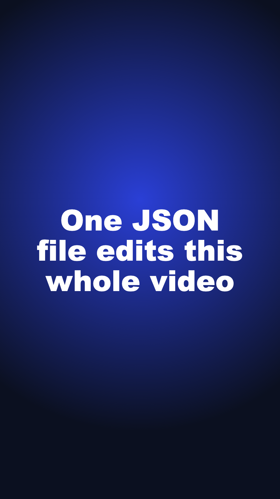

# scene-spec: one JSON file edits the whole short

A small Remotion pipeline. You write one scene spec (JSON), built from reusable scene templates, and one command renders a 1080x1920 short. Scenes, sound cues and caption words all sit on **one shared timeline**: change one scene's length and every later scene, sound effect and caption moves with it.



## Run it

```bash
npm install
node build.mjs specs/repo-explainer.json                  # render one short
node build.mjs specs/repo-explainer.json --compare page=7 # render it twice and compare
```

On an M-series Mac, a 16-second short renders in about 24 seconds.

## What's in the demo folder

| File | What it shows |
|---|---|
| `repo-explainer.mp4` | The short, with the `page` scene at 4s |
| `repo-explainer.page-7s.mp4` | Same spec, with only `page` changed to 7s |
| `repo-explainer.compare.mp4` | Both side by side on one time scale: scene blocks plus a tick for every sound cue |
| `*.timeline.json` | The compiled timeline: every scene, cue and caption as an absolute frame |

Changing `page` from 4s to 7s moves every later cue by exactly 3.00s, with no hand edits:

```
A: whoosh@0.00  click@5.40  pop@7.40   pop@8.30   pop@9.20   pop@10.10  whoosh@13.00
B: whoosh@0.00  click@5.40  pop@10.40  pop@11.30  pop@12.20  pop@13.10  whoosh@16.00
```

## How the timing works

- **Scenes only know their own length.** Nothing in a scene says where it starts. `timeline.mjs` walks the scenes in order and assigns each a start frame.
- **Sounds are pinned to events, not to the clock.** A cue says "at 2.4s into this scene" or `"each_step"`. The compiler turns it into an absolute frame, so a cue moves whenever anything before it changes length.
- **Picture and sound share one source.** The flow template reveals each step at the same frames the compiler pinned the pop sounds to, so they can't drift apart.
- **Cheap checks run first.** The compiler warns before rendering if a scene runs over 8 seconds without a new beat, or if a cue lands past its scene's end.

## First-frame title check (no watching)

`scripts/check_title.py` renders the title layer alone on black to get the exact text pixels, plus the real frame 0. Then, for the 9:16, 3:4 and 1:1 center crops, it checks three things:
- every text pixel survives the crop
- one line of text is at least 3.5% of the crop's height
- text against the background behind it reaches WCAG AA contrast (4.5:1)

```
title check: PASS  contrast 11.3:1  |  9:16 PASS (line=4.6%)  3:4 PASS (line=6.2%)  1:1 PASS (line=8.2%)
```

## Templates

`title` · `ui_demo` (browser card with a visible cursor that follows keyframes and clicks) · `flow` (steps with pinned pops). Captions are word-timed and come from the same timeline.
